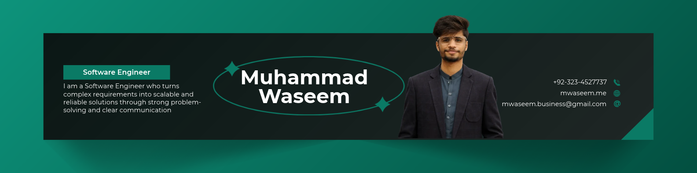

  

<h2 align="center">Hi, I'm Waseem 👋</h2>

  <b>Full-Stack Software Engineer</b> &nbsp;·&nbsp; System Design &nbsp;·&nbsp; Cloud &nbsp;·&nbsp; AI-Assisted Development

  
  
  
  

 

### About me

I'm a software engineer with 2 years of experience building production systems at **Desol Int**. I enjoy working as the architect: designing how services fit together, then shipping solutions that stay scalable and reliable under real traffic.

### What I work on

- **System design**: scalable backends built to handle thousands of requests per second
- **Cloud**: AWS ECS, EKS, EC2, Lambda and load balancing, plus DigitalOcean
- **Payments & invoicing**: production billing systems where every edge case is handled
- **Frontend**: fast, responsive apps with React and Next.js
- **AI-assisted development**: structured workflows with Claude, Codex and Antigravity
- **Every platform**: web, mobile and desktop

### Tech stack

  <b>Frontend & Mobile</b> 
  

  <b>Backend</b> 
  

  <b>Databases</b> 
  

  <b>Cloud & DevOps</b> 
  

---

  Let's talk system design, cloud or AI workflows: <a href="mailto:mwaseem.business@gmail.com">mwaseem.business@gmail.com</a>

